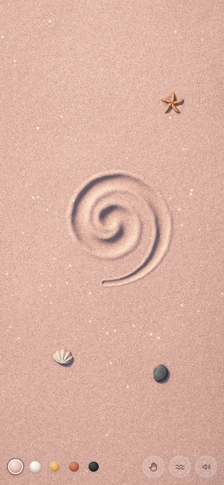
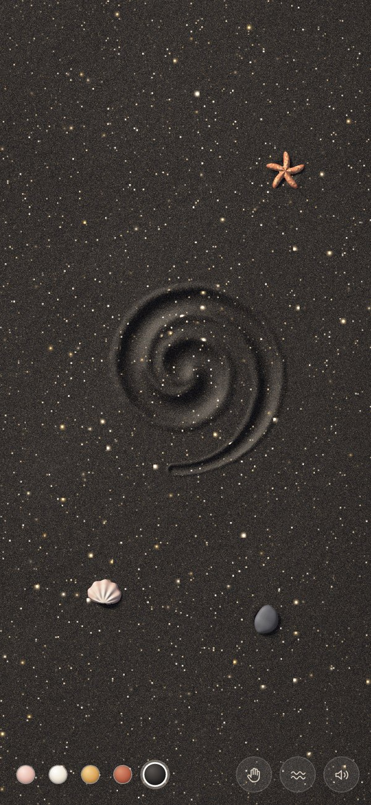

# Sand

*just relax*

Draw on sand with your finger, then let a wave wash it away.

**[▶ Open it](https://vshgit.github.io/sand/)** · best on a phone, with sound on

 &nbsp; 

## Why

I wanted something very small that you simply want to touch: no goal, no score, just a quiet minute.
The rule was one interaction, done carefully enough to feel real.

## Things to try

- **Draw** with one finger. The faster you move, the thinner the line.
- **Smooth the sand** with two fingers, or with the feather from the tools menu.
- **Tilt your phone:** the glitter catches the light.
- **Tools:** a stick, a rake, a feather, and a pebble, a shell and a starfish to place on the sand.
- **The wave** washes everything away and leaves wet sand that slowly dries.
- **Five sands:** rose champagne, Maldives white, golden desert, terracotta canyon and black volcanic.

## How it's made

- One self-contained HTML file running on WebGL. No images, no libraries.
- The sand is a height map simulated on the GPU. Your finger pushes the sand aside into ridges, and the light, shadows and glitter are computed from that relief in shaders.
- The glitter follows the phone's tilt sensor, or the mouse on a computer.
- The wave, the wet sand and the foam are part of the same simulation.
- The sound of sand and water is synthesized live with the Web Audio API.
- The page adapts its quality to keep 60 fps on phones.

Made in an evening with AI-assisted coding.
